# Neuraxis and reflexmesh: architecture and research program

Date: 2026-09-20. Status: engineering design under authorized implementation. No speed, accuracy, generality or novelty result is claimed.

## 1. Decision and scope

Build **Neuraxis**, a software-control workbench, on **reflexmesh**, a separately versioned reusable runtime and Python package. The reusable unit is the event-to-action control loop, not a chat interface. It must work with ordinary deterministic tools, learned policies and interchangeable slow planners. A product-specific dashboard must not be the only way to use it.

The engineering objective is a controller that can respond cheaply to familiar situations, preserve state across observations, recognize when its learned policy lacks support, and obtain more computation when that computation has expected value. Its environment is software: files, processes, local services, tool APIs and agent jobs. It does not promise autonomous access to arbitrary machines or applications.

The scientific object is **budgeted, partially observed, closed-loop software control**. Fast and slow describe computational roles and deadlines. They are not categorical definitions of LLMs, anatomical brain regions or consciousness. An LLM can participate in either role; a non-generative classifier can still be wrong or computationally expensive. The neuroscience and learning dossiers establish these boundaries.

## 2. What is potentially new

Existing work already includes reactive architectures, behavioral policies, learned routing, hierarchical RL, asynchronous LLM planners and outcome-aware execution. DPT-Agent and Instruct-to-Act are especially close architectural antecedents; the learning dossier records their exact evidence. GoEX constrains claims about undo and consequence management; the engineering dossier records it. We should not claim to invent System One, typed decisions, fast/slow agents or computational metareasoning.

The candidate contribution is a **persistent, resource-versioned controller with outcome-grounded allocation of deliberation**, evaluated on software transitions with delayed observations, interrupts and concurrent resource changes. The combination is a research hypothesis, not established novelty. Any paper must make a component-level prior-art comparison and report negative outcomes. A useful product remains useful if the novelty claim fails.

The hypotheses are pre-specified:

| ID | Hypothesis | Required comparison | Refutation |
|---|---|---|---|
| H1 | Bounded recurrent state improves decisions under partial observability | Same features/action candidates; memoryless vs GRU; equal training data and compute accounting | No robust held-out gain or gain vanishes with a simple state estimator |
| H2 | Learning the value of an additional observation or planner call improves the cost-success frontier | Fixed confidence threshold, calibrated learned deferral, always/never delegate and full controller | Gain disappears when planning latency, candidate extraction and teacher cost are counted |
| H3 | Independent invalidation and cancellation handling reduces stale actions during planning | Shared-queue vs separate control-event handling under identical fault schedules | Better latency but unchanged or worse final task correctness |
| H4 | Consolidating verified successful and failed trajectories reduces repeated planner demand without hiding rare failures | No consolidation, successful-only replay and balanced replay with held-out environments | More apparent automation but worse selective risk, recovery or transfer |
| H5 | Predicted consequences help reject actions whose local score is misleading | Candidate scorer vs learned-transition lookahead vs full controller, with model-error reporting | Prediction errors dominate lookahead or simple checks explain all gains |

No single aggregate score can establish all five.

## 3. Runtime architecture

```mermaid
flowchart LR
    Sources[Files, tools, processes, services, agent jobs] --> Ingest[Typed events and provenance]
    Ingest --> State[Versioned entity state and bounded memory]
    State --> Candidates[Capability-filtered action candidates]
    Candidates --> Fast[Fast policy and consequence estimates]
    Fast --> Arbiter[Act, observe, wait, delegate or stop]
    Arbiter --> Check[Preconditions, leases and capability checks]
    Check --> Exec[Supervised effectors]
    Exec --> Verify[Postconditions and outcome reconciliation]
    Verify --> Ingest
    Arbiter --> Planner[Asynchronous slow planner]
    Planner --> Proposal[Versioned plan or skill proposal]
    Proposal --> Check
    Ingest --> Interrupt[Independent invalidation and cancellation]
    Interrupt --> Check
    Interrupt --> Exec
    Verify --> Trace[Append-only episode evidence]
    Trace --> Train[Offline training, calibration and evaluation]
    Train --> Registry[Versioned accepted policies]
    Registry --> Fast
```

### Components and invariants

| Component | Responsibility | Required invariant |
|---|---|---|
| Event ingress | Validate schema, sequence, origin, clocks and payload references | Untrusted payload is data, never runtime authority |
| State reducer | Maintain entities, dependencies, pending jobs, goals and explicit uncertainty | State revision can be reconstructed from the event log |
| Candidate generator | Enumerate allowed tool instances and bind typed argument candidates | Learned scores cannot introduce new capabilities or bypass binding |
| Fast policy | Score candidates plus observe/wait/delegate/stop | Empty or unsupported candidate sets produce abstention, not fabricated action |
| Metacontroller | Allocate computation, deadline and action-risk budgets | Remote deliberation cannot block control-event processing |
| Execution supervisor | Reserve resources, recheck preconditions, execute with deadline | An accepted proposal is not an already-completed action |
| Outcome verifier | Compare observable effects with goal/postconditions | Timeout, cancelled, partial and unknown remain distinct outcomes |
| Learning plane | Construct datasets and produce candidate policies | New weights cannot silently replace a running approved policy |

An initial implementation uses a single serialized state reducer per workspace, with bounded worker pools for inference and execution. Multiple workspaces have separate authority and state. This avoids pretending that distributed consensus is solved by a concurrent queue. Resource leases, revisions and conflict detection provide explicit local coordination; remote systems retain their own transaction semantics.

### Multiple timescales, without biological overclaim

There are three runtime lanes. Exact checks and cancellation admission handle urgent events. A small learned policy handles bounded action selection. Slow planners handle unfamiliar goals, decomposition and proposals. Offline learning consolidates evidence into new policy releases. These are engineering choices inspired by differentiated control timescales; no mapping asserts that a Rust module reproduces a brain structure.

The interrupt lane has reserved queue capacity and a starvation-resistance target within a declared tested load envelope. Bound parser input, reducer/checker critical sections, lock holding, worker admission and synchronous journal I/O; a separate queue alone proves none of these properties. Deadlines are recorded against a monotonic clock. A cooperative cancellation request does not undo completed effects and does not guarantee that a remote provider stopped billing or executing. After cancellation, unresolved writes are reconciled before further actions on the same resource.

## 4. Core contracts

The following is an API specification, not runnable released code.

| Record | Required fields |
|---|---|
| `Event` | schema version, event ID, workspace ID, source ID, trust/provenance tag, source sequence, observed/received times, entity IDs, payload reference/hash, state revision |
| `Goal` | goal ID, declarative success predicate, permitted capabilities, budget, deadline, parent goal, cancellation token, status |
| `ActionSpec` | action ID, tool/provider ID and version, argument schema, effects, read/write resource set, precondition checker, verifier, idempotency mode, cancellation semantics |
| `Candidate` | registered action ID, bound argument reference, entity versions, feasibility reasons, expected cost/duration, grounding evidence |
| `Decision` | candidate ID or abstention reason, policy/model/calibrator hashes, score/distribution, uncertainty evidence, estimated consequence, chosen computation mode |
| `Execution` | unique intent ID, idempotency key if supported, authorization result, lease, start/finish times, provider request IDs, terminal/unknown state |
| `Outcome` | goal and intent IDs, observed effects, postcondition results, reward components, residual uncertainty, recovery requirement |
| `PlanProposal` | planner/version, originating goal, input state revision, dependency DAG, typed action references, assumptions, expiry, expected cost and stop conditions |

Path names and tool descriptions do not prove authority. Canonical resource references and handle-based operations should be used where the platform supports them; path checks alone are vulnerable to symlink/reparse-point races. The execution adapter must enforce the same boundary as the policy runtime. Every public `execute` entry point, including Python and MCP calls, passes through the same broker checks; a direct SDK call cannot bypass the policy boundary.

User-visible goal predicates are distinct from evaluator-only success oracles. Hidden benchmark target IDs, reference actions, future faults and privileged evaluator state never enter the policy input. Replay records nondeterministic observations, model replies, event ordering and decisions, and reconstructs them without redispatching effects. An explicit new execution is a new run, not replay.

For new tasks requiring new strings, code or plans, the slow planner can propose an artifact. The artifact is validated and bound into a registered action before execution. The fast policy does not synthesize arbitrary shell command strings. This still permits useful file/process automation through typed operations and explicitly configured process templates. Subprocess adapters construct direct argument vectors without shell interpolation, validate each argument including option injection, and enforce working-directory/environment boundaries.

### Argument grounding is a first-class problem

A correct tool name with the wrong file or account is an incorrect decision. Candidate generation must measure resource recall, argument validity, unavailable-candidate rate and ambiguity. The same candidate set is exposed to all policies in the controlled ranking experiment. That experiment's LLM baseline is therefore a candidate-selection baseline. A separate end-to-end grounding comparison charges each system for extracting/binding candidates and obtaining observations; it is required for any whole-agent superiority claim. Open-world tasks include an explicit `no_supported_action` outcome and hold out tool descriptions and environment variants. A registered action catalog is a boundary of generality, not evidence of universal tool understanding.

## 5. Formal control problem

Let hidden environment state be \(s_t\), observation/event \(o_t\), goal \(g\), exact observed state/registry \(x_t\), learned temporal state \(h_t\), and remaining budgets \(B_t\). Define controller features \(b_t=(x_t,h_t,B_t)\). Exact observed state is still potentially incomplete or stale; its provenance and revision are explicit. The controller sees a history, not the complete environment:

\[
x_t=\operatorname{reduce}(x_{t-1},o_t),\quad
h_t=f_\theta(h_{t-1},x_t,a_{t-1},y_{t-1}),\quad
\mathcal A_t=\operatorname{admissible}(x_t,g,\mathcal C_t).
\]

Here \(y\) is a verified or unresolved outcome and \(\mathcal C\) is the externally supplied capability/policy set. Deterministic authorization and adapter-level precondition checks define admissibility and are repeated before effects. Learned \(h_t\) cannot grant capabilities or replace authoritative checks. The learned policy ranks only its current candidates, using candidate descriptors so the architecture is not tied to a fixed output index for every tool.

A useful objective minimizes expected episode loss rather than generation length:

\[
J(\pi)=\mathbb E_\pi\left[L_{\mathrm{goal}}+
\sum_t\left(\lambda_c c_t+\lambda_d d_t+\lambda_r r_t+\lambda_m m_t\right)\right].
\]

The quantities are normalized goal loss, monetary/compute cost \(c\), incremental critical-path delay \(d\), explicitly measured adverse-action cost \(r\), and missed-deadline cost \(m\). Concurrent job durations are not summed as if sequential. Coefficients are declared per task profile and frozen before the held-out evaluation. Report each component and the Pareto frontier; a chosen scalar weight is not a universal definition of intelligence.

### When to deliberate

Let \(Q_{\mathrm{act}}(b)\) estimate the best feasible action's expected loss, including explicit wait, refresh and abstain fallbacks so an empty tool-action set is defined. Let computation \(k\) be an observation refresh, bounded lookahead, specialist planner call or longer planner call. The proposed estimate is

\[
\widehat{\mathrm{VOC}}(k,b)=\widehat Q_{\mathrm{act}}(b)
-\widehat{\mathbb E}[Q_{\mathrm{act}}(b'\mid k)]
-\lambda_c\widehat c_k-\lambda_d\widehat d_k
-\lambda_m\widehat{\operatorname{deadlineLoss}}_k.
\]

Choose a supported computation with positive estimated benefit subject to available budget and time. Otherwise act only if the action passes the calibrated acceptance policy; refresh, wait or abstain if it does not. Hard capability checks remain independent of this estimate. An uncertain value-of-computation estimate cannot manufacture a permission.

Here \(b'\) is the state when the computation arrives, after possible concurrent changes, cancellation and staleness. The expectation includes rejected/expired proposals, and \(d_k\) is incremental critical-path delay, not automatically the provider's full runtime. This estimate must be learned from paired resettable sandbox outcomes or supported logged data, not from the planner saying that its own answer was helpful. If planner utility has insufficient data, use the declared conservative baseline and record this limitation. In a live, non-resettable system, the unchosen counterfactual is generally unknown.

### Predicted effects and surprise

Train a transition head \(\widehat p_\phi(o_{t+1},y_t\mid b_t,a_t)\). For categorical outcomes, use negative log likelihood; for continuous observable effects, use a declared likelihood or calibrated residual interval. Prediction mismatch can trigger a refresh or replan. It does not prove maliciousness or causality. Unsupported regions increase abstention and receive separate metrics.

Bounded lookahead searches only registered candidates and uses a measured horizon/action expansion budget. Evaluate both model error and closed-loop control error. A learned world model is not accepted merely because it produces plausible next states.

### Risk and confidence

Temperature or isotonic calibration is fitted on a disjoint calibration split representing the intended deployment mixture, not the artificially balanced training replay pool. Evaluate Brier score, log loss, classwise reliability and risk-coverage curves; report bin counts. Distribution entropy, ensemble disagreement, data support and calibrated correctness probability have different meanings and separate fields.

If deterministic caps \(u_t\) satisfied \(P(F_t\mid H_t)\leq u_t\), then \(P(\text{any failure})\leq\sum_t u_t\) would provide a conservative episode budget without assuming independence. For history-dependent random bounds, the unconditional bound instead requires \(\mathbb E[\sum_t u_t]\). Ordinary marginal calibration establishes neither condition. The release therefore describes an empirical risk policy with confidence intervals, not a mathematical safety guarantee. Formal guarantees may be stated only for exact verified runtime invariants under their documented platform assumptions. Experiments vary observation noise and environment-change rates separately; recurrent within-task adaptation is an alternative to a rigid two-controller split.

## 6. Learning pipeline

1. **Collect:** instrument real sandbox file/process/service tasks and permitted benchmark environments. Capture failures, retries, cancellations and unresolved outcomes, not only successful demonstrations.
2. **Split before fitting:** isolate repository/environment, task template, time and trajectory groups. A paraphrase or another event from the same episode cannot cross the split boundary. Retain an unseen-tool and unseen-fault test suite.
3. **Construct labels:** derive goal success from state predicates and validators. Store teacher proposals as proposals, including rejected ones. Do not replace task truth with model agreement.
4. **Fit baselines:** deterministic policies, calibrated linear/tree scorers, and a small GRU behavior policy. Exact arithmetic and known predicates remain code.
5. **Fit control methods:** contextual bandits on genuine one-step endpoints; masked PPO only in a controlled software simulator; learned transition model and bounded lookahead. Log behavior propensities where off-policy evaluation requires them.
6. **Fit metacontrol:** use paired episodes to label the incremental value of an observation or planner call. Vary latency, queue pressure, tool reliability and budget so the policy does not equate every uncertain event with an expensive call.
7. **Calibrate and stress:** freeze weights, then calibrate on untouched calibration groups; evaluate drift, distractors, missing observations, adversarial payloads and candidate-set changes.
8. **Export and verify:** serialize model, preprocessing, candidate contract, calibrator and licenses together. Check Python/native parity on decisions and scores, near ties, recurrent resets and unknown-action behavior.
9. **Release:** assign immutable policy and feature-contract versions. Shadow evaluation precedes promotion. Retain the prior accepted policy and a deterministic fallback. Online evidence may update metrics; production weights are not self-modified.

Distillation uses verified outcomes as well as teacher actions. Optional KL distillation from a teacher distribution does not turn the student into a calibrated policy automatically. Unknown and cancelled outcomes carry censoring/missingness indicators and are assigned task-specific labels only when observable predicates justify them; they do not silently become zero reward, success or failure. Online exploratory RL against the user's unrestricted workstation is excluded.

## 7. Language and package decision

**Rust owns the resident runtime**: event contracts, state reduction, bounded queues, resource/version checks, scheduling, action supervision and trace production. **Python owns research and integration**: datasets, PyTorch training, classical methods, calibration, benchmark adapters and planner integrations. **TypeScript/React owns the workbench** using the existing CAOS shell.

This choice is based on control over memory ownership, concurrent state and packaging a native daemon/extension, not an unmeasured claim that Rust will dominate every Python implementation. Python plus native inference is a required latency comparator. Go is viable but introduces a different memory/runtime tradeoff and weaker direct reuse of Python training work. C++ offers control but imposes a larger ownership/FFI burden. No language alone supplies hard real-time deadlines on desktop Windows/Linux.

Use PyO3 through **setuptools + setuptools-rust**, preserving the accepted setuptools packaging backend. Maturin is a viable alternative but is not necessary to deviate from ADR-0061. Python-facing methods transfer owned buffers; they must not retain unsafe borrowed objects across asynchronous work. Release interpreter ownership around long native work and test cancellation/lifetime behavior. [Build support](https://setuptools-rust.readthedocs.io/en/latest/), [PyO3 parallelism](https://pyo3.rs/main/parallelism).

ONNX Runtime is the preferred small-policy inference path after parity checks. The `ort` crate is a separate Rust binding; its inspected latest version was `2.0.0-rc.13`, which is a release candidate, not an implicit stability guarantee. Pin a tested compatible runtime/binding pair and verify redistributed native libraries and licenses. If this pair fails a target, use a documented out-of-process inference worker for that platform and measure the additional latency; do not silently label it the native hot path. [Binding documentation](https://docs.rs/ort/latest/ort/).

The Python package should expose `observe`, `decide`, `execute`, `feedback`, `replay` and policy-registry operations as stable concepts, plus a command-line daemon. Training, large model dependencies and external benchmark integrations are optional extras. The base package must install and operate its exact-rule/controller functions without cloud credentials or PyTorch.

MCP is an interoperability adapter, not the internal state machine. Its protocol evolves and its metadata is not authorization. The core action contracts survive protocol-version changes. The engineering dossier records the currently inspected specification and migration boundaries.

## 8. Measurements and proposed targets

These are design targets to validate, not existing measurements:

| Boundary | Initial engineering target | Measurement conditions |
|---|---|---|
| Exact policy plus in-memory checks | Warm p99 <= 2 ms | 64 bound candidates, <=64 KiB validated event, no disk/network/embedding |
| Small learned policy plus checks | Warm p99 <= 10 ms | Fixed CPU thread cap, resident model <=10 million parameters, same bounded inputs |
| Event received to action dispatch | Warm p99 <= 25 ms | Declared arrival rate; include queueing, features, journal boundary and binder |
| Cancellation admission | p99 <= 10 ms | Reserved control queue under declared load; termination/completion measured separately |
| Resident base runtime | <=256 MiB target | Excludes separately reported model weights and optional workers |

Measure cold start, model loading, first event, cache miss and semantic encoding separately and also in the end-to-end trace. Report at least p50/p95/p99, maximum, throughput, deadline misses and memory. A policy benchmark must never be labeled full workflow latency. No hard upper latency guarantee follows from these targets.

The inspected local machine has an Intel i9-14900HX, about 47.7 GiB RAM and an RTX 4070 Laptop GPU reporting 8,188 MiB VRAM. Node reports 24.14.1 and the management Python environment 3.13.14. `rustc`, `cargo` and `uv` were not found on PATH; that does not prove absence elsewhere. Toolchain installation and GPU library compatibility are implementation preflight tasks, not completed here. The CPU deployment path is mandatory; GPU training is optional acceleration with separate evidence.

## 9. Compute discipline

Start with bounded smoke runs that checkpoint and flush progress. Propose a local campaign ceiling of 24 GPU-hours and 100 GB task-specific external cache before re-estimation, with per-run stop criteria for no validation improvement, invalid data or resource exhaustion. These are planning allocations, not measurements or a guarantee that every method fits. A run exceeding its allocation is stopped and its remaining work reported; no partial matrix is presented as a completed product.

Paid provider comparisons get an explicit cost estimate and hard cap before invocation. The plan currently reserves no paid calls and requires no new subscription. A local frozen open-weight planner supplies the reproducible baseline; a cloud frontier planner and Jev can be additional comparisons once lawful access and a cost envelope exist. Record their differing capabilities rather than representing the local baseline as frontier-equivalent.

## 10. Product boundaries and rejection criteria

The product is rejected if it is only a routing wrapper, a set of hand-written rules advertised as learned intelligence, a replay viewer without real tools, an untrained network, or a benchmark scored only by the same teachers used for training. It is also rejected if the learned controller cannot outperform the relevant simpler baseline on its claimed domain, yet the UI presents it as an advance.

The public workbench can import sanitized traces, run sandbox scenarios, inject faults, set budgets, compare decisions, inspect recurrent state/probabilities, cancel jobs and export evidence. A paired local workbench controls explicitly configured local capabilities. A hosted static website cannot directly reach arbitrary local files or run local processes. Local control is served from the local daemon's own origin with authentication/pairing and explicit scope; do not depend on cross-origin remote-site-to-localhost access.

Spiking networks, neuromorphic hardware, liquid networks, large state-space models, full desktop vision and unrestricted self-modifying code are researched alternatives, not promised methods in the approved-scope proposal. Their exclusion is deliberate: each introduces a different data, runtime or validation problem without established benefit for the bounded structured-event workload. Revisit only through a new research-backed scope decision.
